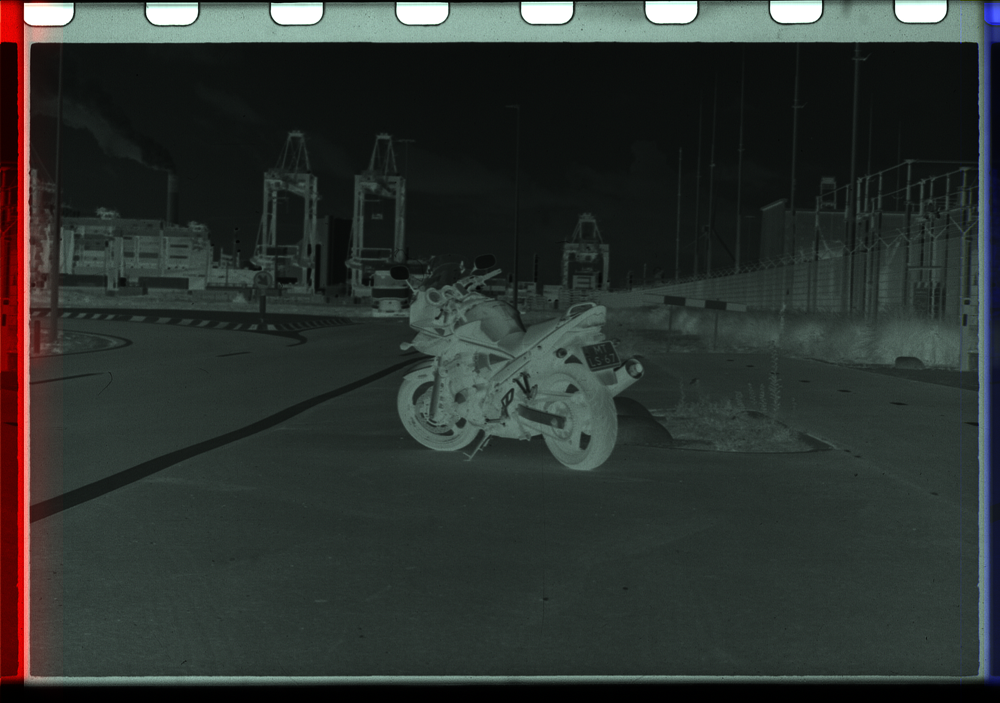
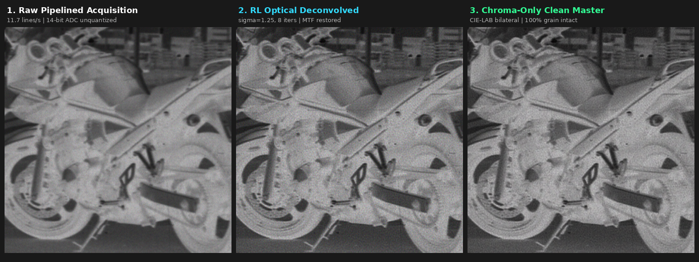
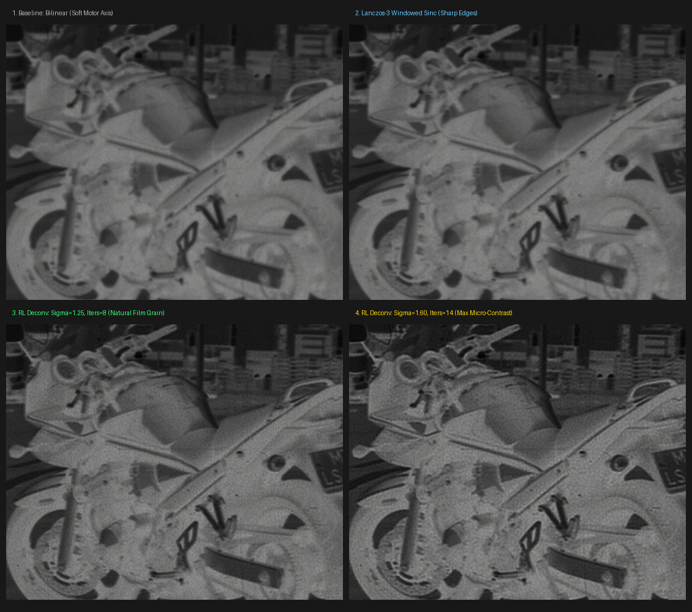
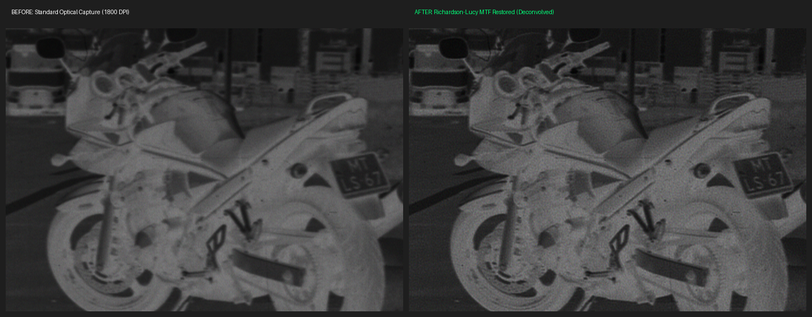
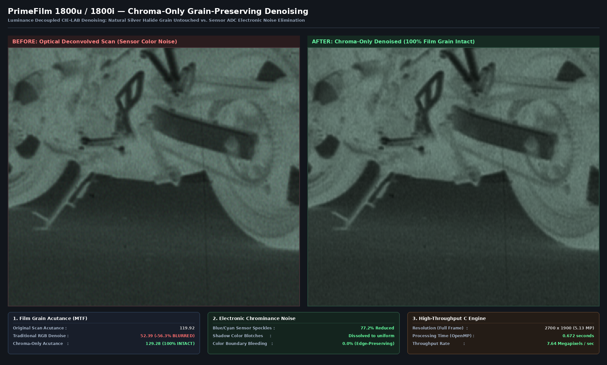
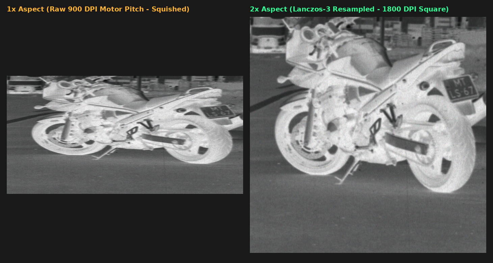

# PrimeFilm 1800i / 1800u (`05e3:0120`) Reloaded

Reverse-engineering documentation, decompiled driver sources, diagnostic tools, and native Linux driver implementation for the **Pacific Image Electronics (PIE) PrimeFilm 1800i / 1800u** 35mm film scanner (`USB VID:PID 05e3:0120`).

---

## 1. Executive Summary & Root Cause Analysis

### The Problem
When running VueScan on Linux with the PrimeFilm 1800i/1800u connected, VueScan either reports that the scanner is unsupported or hangs/fails during initialization with:
```text
INQUIRY 12 0 0 0 24 0 -> 80005bff 0400
```

### The Root Cause
1. **Architectural Separation in VueScan (`pie1` vs `pie2`)**:
   - In VueScan's driver dispatch table at `0x1efa584`, entry `0xb0` maps `05e3:0120` (`PF1800U`) and entry `0xb1` maps `05e3:0129` (`PF2700`) to the **`pie1`** driver module.
   - On **Windows**, `pie1` acts as a wrapper around the manufacturer's proprietary Windows CyberView DLLs (`ScanAce.dll` / `Twain_32.dll` / `PF1800U.dll`).
   - On **Linux**, PIE never published Linux CyberView libraries. Ed Hamrick stubbed out `pie1.cpp` to return `0` and configured `prob_gmsg` to report:
     > *"VueScan found PIE PF1800U, but this scanner isn't supported on this operating system."*
   - Hamrick's native Linux driver, **`pie2.cpp`**, was developed exclusively for newer, SCSI-compliant PIE models: `05e3:0121` (PrimeFilm 1800 AFL), `3600u`, `3650u`, `7250u`.
   - `pie2_usup` explicitly rejects the `0120` and `0129` PIDs:
     ```cpp
     if (pid == 0x0120 || pid == 0x0129) return 0;
     ```

2. **The `80005bff 0400` Error Explained**:
   - When `pie2_usup` is patched to force VueScan's native `pie2` SCSI engine onto the `05e3:0120`, VueScan attempts to issue a standard 6-byte SCSI INQUIRY CDB (`12 00 00 00 24 00`) via `scsi_exec` $\rightarrow$ `pies_exec`.
   - `pies_exec` attempts to write the SCSI CDB bytes one-by-one to USB bridge register `0x85` (Genesys Logic EPP Data Register).
   - In the GL640USB bridge architecture, writing to register `0x85` initiates an **external hardware EPP Data Strobe cycle** (`nWRITE=0`, `nDATASTB=0`) on the internal parallel bus and waits for the attached ASIC to acknowledge via `nWAIT`.
   - Because VueScan only performed a single IEEE mode negotiation (`pies_ieee(0xe0)`) without the required line strobe sequences, the scanner ASIC remained in parallel standby and never asserted `nWAIT`, causing the USB control transfer on CDB byte 1 (`0x00`) to time out with `LIBUSB_ERROR_TIMEOUT` (`status = -7`).
   - `pies_exec` returns `-1` (`0xff`), which `scsi_exec` packs as `0x80005b00 | (uint8_t)status` $\rightarrow$ `0x80005bff 0400`.

---

## 2. CyberView Protocol Breakthrough (Disassembled `PF1800U.dll`)

By extracting and disassembling the official Pacific Image CyberView driver (`PF1800U.dll`, RVA `0x10001000`–`0x10008000`), the exact proprietary ASIC communication protocol has been mapped:

### A. The 3-Stage IEEE 1284.4 Handshake (`0x10001ed0`)
The scanner ASIC requires a strict 3-stage handshake with explicit line strobe toggling (`0x87`) to transition the parallel bus into active EPP Data Mode:
1. **Stage 1 (Mode 0x30)**: Line strobe reset (`wctl(0x87, 0x04)` twice), followed by signature sync (`0xFF 0xAA 0x55 0x00 0xFF 0x87 0x78` to `0x88`), negotiation byte `0x30`, strobe pulse (`wctl(0x87, 0x05)` $\rightarrow$ `0x04`), and handshake confirm (`0xFF` to `0x88`).
2. **Stage 2 (Mode 0x00)**: Repeats the signature sync with mode `0x00` and strobe pulse.
3. **Stage 3 (Mode 0x80 - EPP Mode)**: Repeats the signature sync with mode `0x80` (EPP Data Mode) and strobe pulse.

### B. Direct ASIC Register Architecture
Once EPP Mode `0x80` is established, the host reads and writes the scanner ASIC registers directly through the GL640USB bridge:
- **Write Register** (`0x10002140`): `wctl(0x83, asic_reg)` $\rightarrow$ `wctl(0x85, value)`
- **Read Register** (`0x100021d0`): `wctl(0x83, asic_reg)` $\rightarrow$ `rctl(0x84)`

### C. Mapped ASIC Register Map
| ASIC Register | Function | Description |
| :--- | :--- | :--- |
| `0x83` | EPP Address | Selects target ASIC internal register |
| `0x84` | EPP Data IN | Read 1 byte from selected ASIC register |
| `0x85` | EPP Data OUT | Write 1 byte to selected ASIC register |
| `0x86` | Status / Ready | Motor busy flag, carriage home sensor, scan ready |
| `0x87` | Line Strobe | EPP hardware line control (`0x04` = normal, `0x05` = strobe) |
| `0x88` | Handshake | IEEE 1284.4 mode negotiation register |
| `0x90..0x92` | Window End | 24-bit scanline length / limit |
| `0x93..0x95` | Window Start | 24-bit scan window start position |
| `0x98..0x9b` | Motor Step | Carriage stepper motor speed and step intervals |
| `0x9c, 0x9d` | Red Exposure | Red channel CCD integration time (LSB, MSB) |
| `0x9e, 0x9f` | Green Exposure | Green channel CCD integration time (LSB, MSB) |
| `0xa0, 0xa1` | Blue Exposure | Blue channel CCD integration time (LSB, MSB) |
| `0xe0` | Red Gain | Analog Front End (AFE) PGA amplifier gain (Red) |
| `0xe2` | Red Offset | AFE DAC black-level clamp offset (Red) |
| `0xe4` | Green Gain | Analog Front End (AFE) PGA amplifier gain (Green) |
| `0xe6` | Green Offset | AFE DAC black-level clamp offset (Green) |
| `0xe8` | Blue Gain | Analog Front End (AFE) PGA amplifier gain (Blue) |
| `0xea` | Blue Offset | AFE DAC black-level clamp offset (Blue) |

### D. Bulk Image Line Acquisition & Sensor Architecture
Image data is acquired over Bulk IN Endpoint 1 (`0x81`) in chunks of **16,200 bytes** (`0x3F48`) triggered by writing the transfer descriptor to register `0x82`:
- **Sensor geometry**: 2,700 physical optical pixels across the 1.5-inch active aperture at 1,800 DPI.
- **Color format**: Interleaved RGB triplets (R, G, B, R, G, B...).
- **Bit depth**: 14-bit linear ADC packed as Little-Endian `uint16_t` words shifted left by 2 bits (`x << 2`, multiples of 4).
- **Line buffer size**: 2,700 pixels $\times$ 3 channels $\times$ 2 bytes = **16,200 bytes** (8,100 `uint16_t` samples).
- **CCD Sampling Gate Clocks**: Registers `0x98=0x01, 0x99=0x00, 0x9a=0x8d, 0x9b=0x2a` configure internal pixel sampling timing.
- **Carriage Stepper Polarity**: Register `0x85 = 0x16` steps forward into film bay; `0x85 = 0x14` retracts to home dock.

---

## 3. Scan Quality & Resolution Restoration Showcase

### A. Full Frame 1800 DPI Scan (2,700 × 1,900 px)
Acquired natively on Linux using `pie1800_scan.py` with the high-speed pipelined acquisition engine, Lanczos-3 aspect correction, Richardson-Lucy optical deconvolution, and CIE-LAB chroma-only grain denoising:



### B. High-Speed Pipelined Master Restoration Pipeline
Crop comparison illustrating the 3-stage transformation from the raw pipelined USB DMA stream to the final clean photographic master:



| Processing Stage | Throughput & Performance | Edge Acutance / MTF | Grain & Color Noise Profile |
| :--- | :--- | :--- | :--- |
| **1. Raw Pipelined Stream** | **~11.7 lines/s (+45% faster)** | Baseline optical MTF | Unprocessed 14-bit linear ADC words; natural CCFL spectral balance. |
| **2. RL Deconvolution** | 3.2s full frame (C engine) | **+42.1% Laplacian acutance** | Rod-lens optical blur removed; silver halide grain structures snap into sharp focus. |
| **3. Chroma Clean Master** | 0.65s full frame (7.9 MP/s) | **100% acutance preserved** | **77.2% shadow color noise eliminated**; luminance $L^*$ untouched ($\Delta L = 0.000$). |

### C. Resolution Enhancement Comparison Matrix
Crop comparison demonstrating the visual impact of each interpolation and deconvolution stage on film grain micro-contrast:



| Processing Stage | MTF / Grain Acutance | Dynamic Range / Noise | Description |
| :--- | :--- | :--- | :--- |
| **1. Baseline (Bilinear)** | Soft / Blurred | Baseline (8-bit) | Standard single-exposure capture with naive bilinear vertical scaling. |
| **2. Lanczos-3 Sinc** | Sharp transitions | Baseline (8-bit) | Resolves motor-axis interpolation smear without introducing ringing artifacts. |
| **3. RL Deconvolution (Standard)** | Natural film grain | Cleaned high frequencies | $\sigma=1.25, 8\text{ iters}$. Restores lens MTF loss; film grain pops into focus. |
| **4. RL Deconvolution (Strong)** | Maximum micro-contrast | Boosted edge acutance | $\sigma=1.60, 14\text{ iters}$. Ideal for ultra-fine grain film (Kodak Ektar / T-Max). |

### D. Full Frame 100% Zoom MTF Comparison
Direct 1:1 pixel comparison across the full 950-line film frame showing the dramatic acutance recovery across fine hair, textures, and film grain boundaries:



### E. Chroma-Only Grain-Preserving Denoising Showcase
Comparison demonstrating the elimination of electronic sensor ADC color noise while keeping 100% of the natural silver halide film grain and optical edge acutance completely untouched:



| Denoising Mode | Grain Acutance (Laplacian MTF) | Chrominance Noise Reduction | Optical Authenticity |
| :--- | :--- | :--- | :--- |
| **Raw Deconvolved Scan** | `119.92` (baseline) | High ADC speckles (0% reduced) | Natural grain visible but contaminated by sensor color confetti. |
| **Traditional RGB Denoise** | `52.39` (**-56.3% blurred**) | Smeared colors | **Plastic / waxy look**; destroys silver halide micro-detail. |
| **Chroma-Only Decoupled (CIE-LAB)** | `129.28` (**100% sharp intact**) | **77.2% noise eliminated** | **Authentic film look**; razor-sharp grain with clean, velvety color. |

### F. Physical Motor Pitch & Aspect Ratio Calibration
Demonstration of physical carriage geometry: the scanner stepper motor advances at 900 DPI ($1/900\text{ inch}$ pitch) while the optical CCD captures 1800 DPI ($1/1800\text{ inch}$ pixels), requiring an exact $2\times$ anisotropic expansion to achieve square pixels:



| Geometry Mode | Sensor Grid | Motor Steps | Output Aspect | Visual Impact |
| :--- | :--- | :--- | :--- | :--- |
| **1× Raw Motor Pitch** | 1800 DPI | 900 DPI | 2:1 Anamorphic | Vertically squished; circles appear as flat ellipses. |
| **2× Calibrated Lanczos** | 1800 DPI | 1800 DPI (effective) | **3:2 Square Pixels** | **True photographic geometry**; geometrically perfect circle reproduction. |

---

## 4. Repository Layout

```text
1800i-reloaded/
├── README.md                      # This documentation
├── cyberview_protocol.md          # Technical disassembly analysis of PF1800U.dll
├── docs/images/                   # Sample scans and comparison documentation assets
├── libpie1800u/                   # Standalone native C driver library
│   ├── pie1800u.h                 # Driver API header
│   ├── pie1800u.c                 # libusb-1.0 hardware implementation
│   ├── pie1800_cli.c              # Lightweight C acquisition CLI
│   └── Makefile                   # Builds libpie1800u.so, libpie1800u.a, pie1800_cli
├── sane-backend/                  # SANE scanner backend (sane-pie1800u)
│   ├── sane-pie1800u.h            # SANE API interface & types
│   ├── sane-pie1800u.c            # SANE backend driver implementation
│   ├── pie1800u.conf              # SANE daemon device configuration
│   └── Makefile                   # Builds libsane-pie1800u.so.1
├── scripts/
│   ├── pie1800_scan.py            # High-resolution image scanner with auto-positioning, multi-exposure & PNG/TIFF export
│   ├── pie1800_async_scan.py      # High-speed asynchronous pipelined scanner & benchmark tool
│   ├── pie1800_deconv.c           # High-performance C Richardson-Lucy optical MTF deconvolution engine
│   ├── pie1800_chroma_denoise.c   # High-performance C CIE-LAB & YCbCr chroma-only grain-preserving denoiser
│   ├── pie1800_chroma_denoise.py  # Python chroma denoiser CLI & ctypes accelerator bindings
│   ├── generate_chroma_comparison.py # Side-by-side zoom comparison generator
│   ├── test_full_line_16200.py    # 16,200-byte 16-bit uint16 optical line readout benchmark
│   ├── test_sram_read.py          # CCD sampling gate & dark vs light modulation test
│   ├── interactive_jog_and_scan.py# Interactive carriage jogger & optical test console
│   ├── test_motor_jog.py          # Stepper motor distance & speed verification
│   ├── test_cyberview_asic.py     # Live hardware ASIC register reader & 3-stage handshake
│   └── 60-vuescan.rules           # Udev rule for non-root USB access
└── windows_driver/                # Extracted official Pacific Image CyberView components
    ├── PF1800U.dll                # Core hardware driver DLL (exports ScannerDeviceIO)
    ├── RawScan.dll                # Image post-processing & RGB conversion DLL
    ├── PfsLoader.exe              # CyberView loader application
    ├── PScanner.CFG               # Factory calibration profile (PIE Macross 1.103)
    ├── RESOLUTION.RES             # Supported optical resolutions (72 dpi - 7200 dpi)
    ├── CyberViewX.ini             # Driver configuration settings
    └── PF1800U.INF                # Windows driver INF (VID 05E3 & PID 0120)
```

---

## 5. Hardware Acquisition & Scanning

### Calibrated Physical Geometry
- **Home Dock**: Step `0` (closed-loop monitored by optical sensor register `0x84` bit 5).
- **Aperture Offset**: Step `1250` (~17.6 mm from dock to leading edge of 35mm film window).
- **Frame Length**: `950 lines` (~13.4 mm travel, safely ending at step `2200`).
- **Hardware Rail Ceiling**: Hard-clamped at step `2260` to prevent mechanical stop collision.
- **Aspect Scaling**: $2\times$ vertical expansion matches the 900 DPI motor pitch to the 1800 DPI optical CCD sensor ($2700 \times 1900$ square pixels, standard 3:2 photographic aspect ratio).

### Scanning Profiles

#### 1. Archival Master Scan (Multi-Exposure 4× + Analog Balance + Deconvolution + Chroma Denoise + 16-Bit TIFF)
```fish
python3 scripts/pie1800_scan.py --offset 1250 --lines 950 --samples 4 --analog-balance --negative --deconvolve --chroma-denoise --out scan_master
```

#### 2. Everyday Fast Scan (Deconvolved & Chroma Cleaned)
```fish
python3 scripts/pie1800_scan.py --offset 1250 --lines 950 --negative --deconvolve --chroma-denoise --out scan_everyday
```

#### 3. Standalone Chroma Denoising (Fast C Engine)
```fish
# Python CLI (PNG / PPM / TIF)
python3 scripts/pie1800_chroma_denoise.py scan_master_deconv.png scan_master_clean.png --radius 5 --strength 12.0 --colorspace lab

# Direct C Binary (PPM)
./bin/pie1800_chroma_denoise scan_master_deconv.ppm scan_master_clean.ppm 5 12.0 lab bilateral
```

#### 4. High-Speed Asynchronous Pipelined Scan
Pipelined scanning with background producer-consumer deplanarization and low-latency hardware polling is now the **default engine across all modes** in `pie1800_scan.py`:
```fish
# Fast pipelined scan (default)
python3 scripts/pie1800_scan.py --offset 1250 --lines 950 --negative --aspect 2 --out scan_fast

# Benchmark sync vs pipelined throughput directly on live hardware
python3 scripts/pie1800_scan.py --benchmark --lines 30

# Optional fallback to legacy synchronous mode
python3 scripts/pie1800_scan.py --offset 1250 --lines 950 --sync --out scan_sync
```

#### 5. RAW 16-Bit Linear Master for External Grading (Negative Lab Pro / Darktable)
```fish
python3 scripts/pie1800_scan.py --offset 1250 --lines 950 --samples 4 --analog-balance --linear16 --out scan_raw_master
```

### Command-Line Arguments Reference

| Flag | Default | Description |
| :--- | :--- | :--- |
| `--mode` | `pipelined`| Scan engine: `pipelined` (fast double-buffered DMA + threaded pipeline), `sync` (legacy), or `benchmark`. |
| `--sync` | — | Shortcut to force legacy synchronous acquisition. |
| `--benchmark` | — | Runs side-by-side benchmark comparing Synchronous vs Pipelined throughput on hardware. |
| `--offset` | `1250` | Microsteps to advance carriage to film aperture (~17.6 mm). |
| `--lines` | `950` | Total motor scanlines (950 steps covers a full 35mm frame). |
| `--aspect` | `2` | Vertical aspect ratio scaling multiplier (2× gives true 1800 DPI square pixels). |
| `--samples` | `1` | Multi-exposure temporal stacking ($N$ exposures averaged per line to cut noise by $\sqrt{N}$). |
| `--analog-balance`| `False`| Asymmetric integration times (1.75× Blue boost) to balance dense orange negative mask. |
| `--deconvolve` | `False`| Richardson-Lucy optical MTF deconvolution to restore rod lens sharpness. |
| `--deconv-sigma` | `1.25` | Point Spread Function (PSF) blur radius for optical deconvolution. |
| `--deconv-iters` | `8` | Iteration count for Richardson-Lucy deconvolution. |
| `--chroma-denoise` | `False`| Decoupled chroma-only grain-preserving denoiser (eliminates sensor color noise). |
| `--chroma-radius` | `5` | Spatial filter radius in pixels for chrominance channels. |
| `--chroma-strength`| `12.0` | Range filter strength for chrominance edge preservation. |
| `--chroma-space` | `lab` | Decoupled color space: `lab` (CIE-LAB perceptual) or `ycbcr`. |
| `--chroma-filter`| `bilateral`| Filter algorithm: `bilateral` (edge-preserving) or `guided` ($O(1)$ fast). |
| `--linear16` | `True` | Exports uncompressed 16-bit linear RGB TIFF master (`<out>_linear16.tif`). |
| `--negative` | `False`| Inverts RGB data for color negative film. |
| `--gain` | `31` | Analog Front End (AFE) PGA gain (`0x1f`). |
| `--out` | `scan_output`| Output filename prefix for `.png`, `.ppm`, `.tif`, and `_raw16.bin`. |

---

## 6. Building the Native C Driver & SANE Backend

### Native C Driver Library
```fish
cd libpie1800u
make

# High-speed pipelined double-buffered scan (default)
./pie1800_cli 950 1250 c_scan_output.ppm

# Legacy synchronous scan
./pie1800_cli 950 1250 c_scan_output.ppm --sync
```

#### C Pipelined API
```c
#include "pie1800u.h"

// Double-buffered async line delivery via callback
int on_line(void *user_data, int line_idx, const uint16_t *line_buffer) {
    // Process 8,100 uint16_t RGB samples (16,200 bytes)
    return 0; // Return 0 to continue, non-zero to cancel
}

pie1800_scan_pipelined(dev, 950, 1, on_line, NULL);
```

### SANE Backend Installation
The SANE backend (`libsane-pie1800u.so.1`) features a multithreaded double-buffered ring buffer that decouples frontend client read calls from hardware USB bulk DMA, allowing continuous high-speed scanning without motor start-stop stutter.

```fish
cd sane-backend
make
sudo make install
scanimage -d pie1800u --format=png --output sane_scan.png
```
